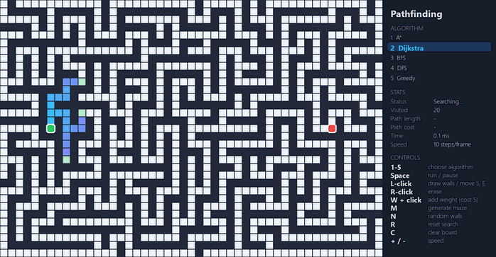

# Pathfinding Visualizer


An interactive tool that shows how graph search algorithms explore a grid. Draw walls, add weighted cells, generate a maze and watch each algorithm work step by step.

<p align="center">
  
</p>

*Dijkstra and then A\* solving the same maze. A\* reaches the goal after visiting fewer cells because its heuristic points it toward the target.*

## Algorithms

| Algorithm | Weighted | Shortest path | Notes |
|---|---|---|---|
| **A\*** | ✅ | ✅ | Dijkstra plus a Manhattan-distance heuristic; ties broken by distance to goal |
| **Dijkstra** | ✅ | ✅ | Expands the cheapest node first using a binary heap |
| **BFS** | ❌ | ✅ (unweighted) | Explores layer by layer with a queue |
| **DFS** | ❌ | ❌ | Goes deep first with a stack; finds *a* path, rarely the best one |
| **Greedy best-first** | ❌ | ❌ | Follows only the heuristic; fast but can be misled |

Every algorithm is a Python generator that yields after each expanded node. The UI pulls a few steps per frame, which is what makes the animation possible without threads.

Mazes are generated with a randomized depth-first search (recursive backtracker), so every maze is a *perfect* maze with exactly one route between any two cells.

## Getting started

```bash
pip install -r requirements.txt
python main.py
```

## Controls

| Input | Action |
|---|---|
| `1`–`5` | Choose algorithm |
| `Space` | Run / pause |
| Left click + drag | Draw walls, or drag the start/end node |
| Right click + drag | Erase |
| `W` + left click | Add a weighted cell (cost 5) |
| `M` | Generate a maze |
| `N` | Random walls |
| `R` | Reset the search, keep the board |
| `C` | Clear the board |
| `+` / `-` | Change speed |

The side panel shows the number of visited cells, path length, total path cost and the time spent searching.

## Project structure

```
pathfinder/
├── grid.py         # Grid model: walls, weights, neighbours
├── algorithms.py   # A*, Dijkstra, BFS, DFS, Greedy as step generators
├── maze.py         # Maze and random wall generation
└── app.py          # pygame UI
scripts/
└── record_demo.py  # Renders docs/demo.gif headlessly
tests/
└── test_algorithms.py
```

## Tests

```bash
pip install pytest
pytest
```

The tests check that every algorithm returns a valid path, that BFS, Dijkstra and A\* agree on the shortest length, that weighted search avoids expensive cells, that A\* expands fewer nodes than Dijkstra, and that generated mazes are always solvable.
